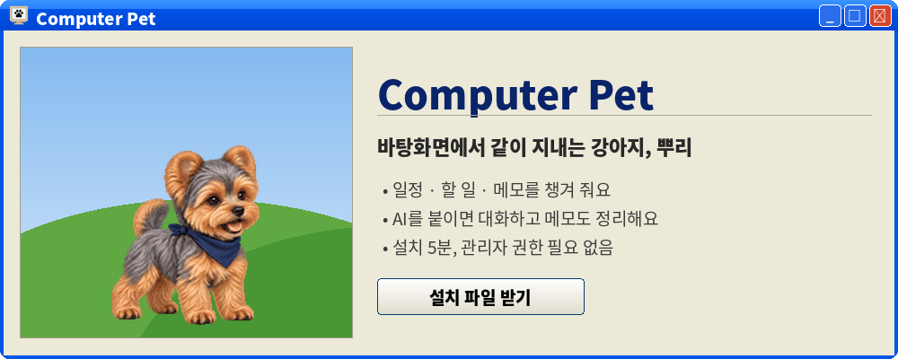

<p align="center">
  <a href="https://github.com/jeonjimin-root/computer-pet-release/releases/latest/download/ComputerPet-Setup-1.0.0.exe"></a>
</p>

<p align="center">
  <a href="https://github.com/jeonjimin-root/computer-pet-release/releases/latest/download/ComputerPet-Setup-1.0.0.exe"></a>
  <br><sub>약 47 MB · Windows 10 · 11</sub>
</p>

<p align="center">
  <a href="https://github.com/jeonjimin-root/computer-pet-release/releases/latest"></a>
  
  
</p>

<br>

<table align="center">
<tr>
<td align="center" width="200"><b>❶</b><br>받아서 설치</td>
<td align="center" width="200"><b>❷</b><br>이름 정하고 첫 대화</td>
<td align="center" width="200"><b>❸</b><br>우클릭으로 메뉴</td>
</tr>
</table>

<br>

## 1. 받기

위의 **설치 파일 받기**를 누르면 바로 내려받아져요. [릴리스 페이지](https://github.com/jeonjimin-root/computer-pet-release/releases/latest)에서 `ComputerPet-Setup-x.x.x.exe`를 받아도 돼요.

> [!NOTE]
> 엣지에서 오른쪽 위 다운로드 칸에 <b>"일반적으로 다운로드되지 않습니다"</b>가 뜨면:
> **···** → **유지** → 아래 창에서 **삭제** 옆 **∨** → **그래도 계속**. (크롬은 **계속** 한 번)
> 개인이 만든 프로그램이라 뜨는 안내예요.

## 2. 설치

1. 받은 파일을 더블클릭해요.
2. 파란 창 <b>Windows의 PC 보호</b>가 뜨면 **추가 정보 → 실행**. 안 뜨면 그냥 넘어가요.
3. **다음**을 눌러 끝까지 가요. "바탕 화면에 바로 가기"는 켜 두는 게 편해요.
4. **마침**을 누르면 뿌리가 화면에 떨어져요.

<p align="center"></p>

## 3. 처음 켜면

안내 창이 뜨고 세 단계만 지나면 돼요.

| | 단계 | 하는 일 |
| :-: | :--- | :--- |
| 🐶 | **이름** | 기본은 "뿌리". 다른 이름을 지어 줘도 돼요. |
| 🔌 | **AI 연결** | 지금 안 해도 돼요. **건너뛰기** → 나중에 설정에서. |
| 💬 | **첫 대화** | 뿌리가 이름·하는 일·근무 시간·좋아하는 것을 물어봐요. 답하면 기억해 두고 그에 맞춰 알려 줘요. |

> [!TIP]
> 회사를 안 다니면 근무 시간에 <b>"안 다녀"</b>라고 하세요. 출퇴근 알림이 꺼져요.
> 답하기 싫은 질문은 비운 채 Enter. 나중에 바꾸려면 뿌리 우클릭 → **설정**.

## 4. AI 연결 <sub>(선택)</sub>

AI를 연결하면 뿌리와 대화하고, 말로 일정·할 일을 넣고, 메모를 정리할 수 있어요.
연결 안 해도 일정·할 일·메모는 직접 적어서 그대로 써요.

<details open>
<summary><b>🟢 &nbsp;가장 쉬운 방법 — Google (무료)</b></summary>
<br>

1. 뿌리 우클릭 → **설정** → **AI** 탭 → Google 줄의 **키 받기** → 브라우저가 열려요.
2. 구글 계정으로 로그인 → **Create API key** → 나온 긴 글자를 복사.
3. 설정 창으로 돌아와 **붙여넣기** → **확인**. **연결됨**이 뜨면 끝.

> [!IMPORTANT]
> 이 키는 비밀번호 같은 거라 남에게 보내지 마세요.
> 무료 등급에서는 대화 내용이 Google 서비스 개선에 쓰일 수 있어요. 개인정보나 회사 기밀은 대화에 넣지 마세요.

</details>

<details>
<summary><b>⚪ &nbsp;ChatGPT · Claude를 구독 중이면</b></summary>
<br>

같은 화면의 ChatGPT·Claude 줄에서 **설치 → 로그인**을 차례로 누르면 돼요.
설치는 검은 창이 열려 진행되고, 로그인은 브라우저에서 해요. 키 복사는 필요 없고 구독량을 같이 써요.

</details>

## 5. 쓰는 법

뿌리를 **우클릭**하면 메뉴가 나와요. **두 번 클릭**하면 바로 대화예요.

| | 메뉴 | 하는 일 |
| :-: | :--- | :--- |
| 💬 | **대화하기** | 뿌리와 이야기. "다음 주 화요일 3시 치과"처럼 말하면 일정으로 기억해요 <sub>AI 필요</sub> |
| 📅 | **일정** | 직접 넣고 고쳐요. 반복 일정, D-day도 돼요 |
| ✅ | **할 일** | 오늘 할 일 목록. 끝내면 체크 |
| 📝 | **메모** | 첫 줄이 제목, Ctrl+S 저장. 메모 목록에서 **책으로 보기**, **AI로 정리** <sub>AI 필요</sub> |
| 🖥️ | **화면 점검** | 화면 일부를 골라 AI에게 보여 주고 묻기 <sub>AI 필요</sub> |
| 🍖 | **밥 주기** | 점심 알림 시간에 배고프다고 해요. 얼마 뒤 똥을 남기는데, 클릭하면 치워져요 |
| ⚙️ | **설정** | 이름·성격·말투, AI 연결, 근무 시간·알림. **사용법** 탭에 자세한 설명 |
| 👋 | **숨기기** | 잠깐 감춰요. 트레이의 뿌리 아이콘 우클릭 → 다시 보이기 |

<br>

> 🐾 &nbsp;뿌리를 끌어서 원하는 자리에 놓을 수 있고, 모니터가 두 대면 알아서 건너다녀요.
> 버튼을 누르지 않고 뿌리 위에서 마우스를 좌우로 문지르면 쓰다듬어짐이에요.

## 6. 업데이트

새 버전이 나오면 뿌리가 말풍선으로 알려 줘요. **업데이트**를 누르면 받아서 설치하고 스스로 다시 켜져요. 일정·메모는 그대로 남아요.

바쁘면 **나중에**. 직접 확인하려면 설정 → 기타 → **업데이트 확인**.

## 7. 문제가 생기면

<details>
<summary><b>뿌리가 안 보여요</b></summary>
<br>

작업 표시줄 오른쪽 아래 트레이(∧ 표시)에서 뿌리 아이콘 우클릭 → **다시 보이기**.
그래도 없으면 시작 메뉴에서 **Computer Pet**을 다시 실행하세요.

</details>

<details>
<summary><b>이상하게 동작해요</b></summary>
<br>

우클릭 → **종료** 후 다시 실행. 그래도 그러면 아래 폴더의 파일을 보내 주세요. 탐색기 주소칸에 그대로 붙여넣으면 열려요.

```
%LOCALAPPDATA%\ComputerPet\Logs
```

</details>

<details>
<summary><b>제거하고 싶어요</b></summary>
<br>

Windows 설정 → 앱 → **Computer Pet** → 제거.
일정·메모는 지우지 않아서 다시 설치하면 그대로예요. 완전히 지우려면 `%LOCALAPPDATA%\ComputerPet` 폴더를 지우세요.

</details>

<br>

<p align="center"><sub>내 일정·메모는 내 컴퓨터에만 저장돼요. 매일 자동 백업되고, 설정 → 백업에서 되돌릴 수 있어요.</sub></p>

<p align="center"></p>
