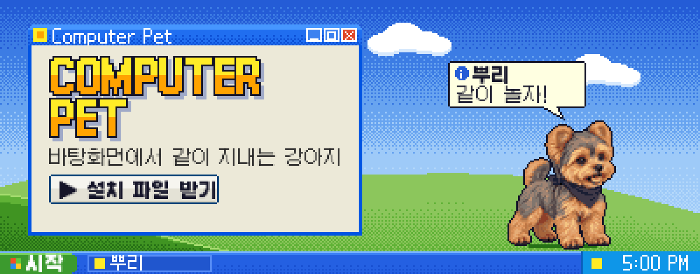

  

  
   Windows 10 · 11

 

바탕화면에 강아지를 한 마리 들이는 프로그램입니다. 일정과 할 일을 챙겨 주고, 말을 걸면 대답합니다.

## 🐾 설치하기

### 1. 받아서 더블클릭

받는 도중에 브라우저가 "일반적으로 다운로드되지 않습니다"라고 알리면 `···` → **유지** → 삭제 옆 `∨` → **그래도 계속**을 누르십시오. 실행할 때 파란 "Windows의 PC 보호" 창이 뜨면 **추가 정보** → **실행**입니다. 개인이 만든 프로그램이라 나오는 경고입니다.

### 2. 다음, 다음, 마침

설치가 끝나면 펫이 화면에 나타납니다.

### 3. 처음 설정

안내 창이 열리고 세 가지를 정합니다.

**이름** — 기본은 "뿌리"입니다. 다른 이름을 지어 주어도 됩니다.

**AI 연결** — 하나를 연결해야 다음으로 넘어갑니다. 대화와 일정 기억에 쓰입니다.

구글이 가장 쉽고 무료입니다.

1. Google 줄의 **키 받기**를 누르면 브라우저가 열립니다.
2. 구글 계정으로 로그인하고 **Create API key**를 누르면 긴 글자가 나옵니다. 복사하십시오.
3. 설정 창으로 돌아와 **붙여넣기** → **확인**. "연결됨"이 뜨면 끝입니다.

ChatGPT나 Claude를 구독 중이라면 그 줄에서 **설치** → **로그인**만 누르면 됩니다.

> 💡 받은 키는 비밀번호와 같으니 다른 사람에게 알려 주지 마십시오. 결제 수단을 등록하지 않으면 요금이 발생하지 않습니다. 무료 등급에서는 대화 내용이 구글 서비스 개선에 쓰일 수 있으니, 회사 자료나 민감한 내용은 입력하지 마십시오.

**웹 검색** — 최신 정보를 찾아볼지 고릅니다. 나중에 설정에서 바꿀 수 있습니다.

 

여기까지면 끝입니다. 다음부터는 **펫을 우클릭**하면 메뉴가 나오고, 자세한 사용법은 **설정 → 사용법** 탭에 적어 두었습니다.

이상한 점이 있으면 알려 주십시오. 같이 보겠습니다.
